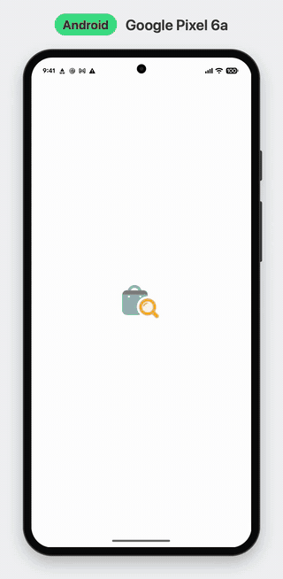

# Product Explorer

A React Native (Expo) product catalogue built to production standards: offline-first, with an encrypted cache, infinite scroll, and spec-driven tests from the domain layer up to end-to-end flows.

[](https://github.com/zobaer53/RN_Product_listing_Demo/actions/workflows/ci.yml)
[](https://github.com/zobaer53/RN_Product_listing_Demo/actions/workflows/android-debug.yml)


---

## Contents

[Showcase](#showcase) · [Download the debug APK](#download-the-debug-apk) · [Features](#features) · [Infinite scroll](#infinite-scroll-note) · [Tech stack](#tech-stack-and-why) · [Architecture](#architecture) · [Best practices](#best-practices-followed) · [Security](#security-considerations) · [Offline-first](#offline-first) · [Testing](#testing) · [CI/CD](#cicd) · [Getting started](#getting-started) · [Project structure](#project-structure) · [Known limitations](#known-limitations-and-next-steps)

## Showcase

<!-- showcase: generated by scripts/media/make-showcase.sh -->

Recorded on a **real Google Pixel 6a** (Android 17) running the standalone debug APK against the live API. The demo is scripted with Maestro (`.maestro/showcase/showcase.yaml`):

cold start → skeleton → list → infinite scroll → product details (gallery, specs, reviews) → back → pull to refresh → **airplane mode**: offline banner over the cached list and cached details → reconnect.

<p align="center">
  
</p>
<p align="center"><a href="docs/media/showcase-android.mp4">Full video (MP4, 1.4 MB)</a></p>

The video is reproducible: a script sets a clean status bar, records the device while Maestro drives the demo, and places the recording in a device frame with a caption. See [`scripts/media/README.md`](scripts/media/README.md).

## Download the debug APK

Every push to `main` runs the [Android debug APK workflow](https://github.com/zobaer53/RN_Product_listing_Demo/actions/workflows/android-debug.yml). It builds a **signed, standalone debug APK** with the JavaScript bundle embedded, so no Metro server is needed.

1. Open the latest successful run of **Android debug APK** in the Actions tab.
2. Download the `android-debug-apk` artifact (a zip containing `product-explorer-debug-<sha>.apk`). You need to be signed in to GitHub.
3. Install it:
   - **adb:** `adb install -r product-explorer-debug-<sha>.apk`
   - **Sideload:** copy the APK to the phone, open it, and allow "Install unknown apps" for your file manager when prompted.

> If the APK was signed with the default debug key (see [CI/CD](#cicd)), uninstall any previous build before installing a new one.

## Features

- **Product listing:** 2-column grid with image, title, price, rating and a discount ribbon. "Showing X of 194" counter.
- **Product details:** image carousel, price with the original price struck through, fractional rating stars, availability, description, specifications and reviews.
- **Infinite scroll:** pages of 10, with per-page loading, error and retry states and an end-of-list message.
- **Offline-first:** cached content renders instantly, also offline, with an "offline · updated X ago" banner. Requests pause offline and resume on reconnect.
- **Encrypted cache:** the persisted query cache is AES-256 encrypted with a key held in the iOS Keychain / Android Keystore.
- **Every state designed:** loading skeletons, empty, error with retry, offline with and without cache, refresh failure snackbar, not found.
- **Deep links:** `productexplorer://products/{id}` opens a product directly. Invalid ids show "not found" without a network call.
- **Accessibility:** screen-reader labels and roles, WCAG AA colour variants for small text, Reduce Motion support, capped font scaling on dense cards, 44 pt touch targets.

## Infinite scroll note

The brief's endpoint is `https://dummyjson.com/products?limit=10`. The app keeps **pages of 10** and loads further pages with `skip` as you scroll:

```
GET /products?limit=10&skip=0&select=…    → items 1–10   (total: 194)
GET /products?limit=10&skip=10&select=…   → items 11–20
…
GET /products?limit=10&skip=190&select=…  → items 191–194 → "You've seen all 194 products"
```

- `useInfiniteQuery` with `getNextPageParam = nextSkip(page)`. Pages are flattened and de-duplicated by `id`.
- `select` keeps list payloads small. Details are fetched in full per product.
- **Per-page errors:** if page N fails, the loaded items stay visible and the footer offers **Retry** for that page only.
- **Offline:** the footer shows "Connect to load more", and loading resumes automatically when the device is back online.
- Pull to refresh refetches the loaded pages in order.

## Tech stack and why

| Concern              | Choice                                                         | Why                                                                                                                              |
| -------------------- | -------------------------------------------------------------- | -------------------------------------------------------------------------------------------------------------------------------- |
| Runtime              | **Expo SDK 58** (RN 0.88) with **CNG** and a development build | Managed upgrades, config plugins for native changes, reproducible native projects in CI; `android/` and `ios/` are not committed |
| Navigation           | **Expo Router** (typed routes)                                 | File-based routes, deep links for free, thin route files                                                                         |
| UI library           | **React Native Paper (MD3)**                                   | The closest RN equivalent of MUI: mature, accessible by default (roles, focus, touch targets), fully themeable from our tokens   |
| Custom graphics      | **React Native Skia**                                          | GPU shimmer, discount ribbon, fractional rating stars and state illustrations                                                    |
| Animation            | **Reanimated 4**                                               | UI-thread animations that drive Skia values                                                                                      |
| Server state         | **TanStack Query v5**                                          | Caching, retries, infinite queries, persistence, offline pausing                                                                 |
| Client state         | **Zustand v5**                                                 | Tiny, explicit client state (connectivity only). Server data is never copied into it                                             |
| Validation           | **Zod v4**                                                     | Parses every API response at the boundary, and route params                                                                      |
| Local storage        | **react-native-mmkv v4** (AES-256)                             | Fast synchronous key-value store with built-in encryption                                                                        |
| Key storage          | **expo-secure-store**                                          | iOS Keychain / Android Keystore for the encryption key                                                                           |
| Randomness           | **expo-crypto**                                                | Cryptographically secure random bytes for the key                                                                                |
| Connectivity         | **@react-native-community/netinfo**                            | Online/offline signal for TanStack Query and the UI                                                                              |
| Images               | **expo-image**                                                 | Memory and disk cache (images work offline), placeholders, transitions                                                           |
| Lists                | **FlashList v2**                                               | Recycled, fast 2-column infinite grid                                                                                            |
| Unit and integration | **Jest + React Native Testing Library + MSW**                  | Spec tests from pure domain helpers to whole screens, with the network mocked at the HTTP layer                                  |
| End-to-end           | **Maestro**                                                    | Readable YAML flows on real devices, emulators and simulators                                                                    |
| CI/CD                | **GitHub Actions**                                             | Verify on every push and PR, signed debug APK and Maestro smoke tests on `main`                                                  |

All native dependencies are installed with `npx expo install`, so versions match the SDK.

## Architecture

**Feature-first + clean architecture.** All product code lives in `src/features/products`. Inside a feature, dependencies point inward only: `presentation → domain ← data`.

```
 ┌──────────────────────────── presentation ────────────────────────────┐
 │ src/app routes (thin) → Screens → Components (Paper + Skia)          │
 │   hooks: useProductsInfinite(), useProduct(id)   (TanStack Query)    │
 └───────────────────────────────┬──────────────────────────────────────┘
                                 ↓ calls use cases
 ┌──────────────────────────────── domain ──────────────────────────────┐
 │ Use cases: getProductsPage({limit, skip}), getProductById(id)        │
 │ Entities: ProductSummary, Product, Review, Page<T>                   │
 │ Interface: ProductRepository     Helpers: nextSkip, originalPrice    │
 └───────────────────────────────┬──────────────────────────────────────┘
                                 ↑ implements
 ┌──────────────────────────────── data ────────────────────────────────┐
 │ ProductRepositoryImpl → ProductRemoteDataSource → core/http-client   │
 │ Zod DTO schemas · mappers (reviewer emails dropped here)             │
 └──────────────────────────────────────────────────────────────────────┘
 core/   http client · AppError · query client · encrypted persister · key provider · connectivity
 shared/ theme tokens · Paper theme · state views · Skia components · testIDs
```

**Dependency rules**, enforced by ESLint (`import/no-restricted-paths`) on every commit and in CI rather than only documented:

| From → To                                      | Allowed                                             |
| ---------------------------------------------- | --------------------------------------------------- |
| `src/app` → a feature's public `index.ts`      | yes (nothing deeper)                                |
| feature → another feature                      | **no**                                              |
| `domain` → anything outside `domain`           | **no** (only `@core/errors`; no React, Expo or Zod) |
| `data` → `domain`, `core`                      | yes; never `presentation` or `shared`               |
| `presentation` → `domain`, `shared`, `core`    | yes; **never `data`** (only via the feature module) |
| `shared` → features · `core` → shared/features | **no**                                              |

Wiring happens in one composition root (`products.module.ts`). There is no DI framework.

## Best practices followed

- **SOLID**
  - _Single responsibility:_ data source (HTTP), mapper (DTO → entity) and repository (orchestration) are separate files with one reason to change each.
  - _Open/closed:_ state views (`ErrorState`, `EmptyState`, …) are extended through props and slots, not edited per screen.
  - _Interface segregation:_ `ProductRepository` exposes just two methods.
  - _Dependency inversion:_ use cases depend on the `ProductRepository` interface. The concrete implementation is wired once in `products.module.ts`, so tests swap it freely.
- **KISS / YAGNI / DRY:** one cache (TanStack Query, persisted) instead of a second local database; no Redux or DI framework; one `AppError` model, one theme source, one testID registry.
- **Spec-driven development:** behaviour was specified first in a spec catalogue (IDs like `DOM-03`, `DATA-05`, `LIST-06`, `E2E-08`). Each spec got a failing test before the code, and tests are named by spec ID, e.g. `it('[DATA-05] drops reviewerEmail', …)`.
- **Parse, don't trust:** JSON → Zod schema → DTO → mapper → domain entity. Malformed responses become a typed `parse` error instead of a crash deep in the UI.
- **Single source of truth for server state:** TanStack Query owns server data. Zustand only holds client state (connectivity).
- **Typed errors:** `AppError = offline | timeout | network | http{status} | parse | unknown` drives the retry policy (no retries for 4xx or parse errors) and the user-facing copy.
- **Strict TypeScript:** `strict`, `noUncheckedIndexedAccess` and `noImplicitOverride`, with `tsc --noEmit` in CI.
- **Container / presentational split:** screens connect hooks to state; components render props only, so they are tested with fixtures.
- **Accessibility:** WCAG AA colour variants for small text, labels and roles on interactive elements, Reduce Motion disables the shimmer, font scaling capped only where layout demands.
- **Performance:** FlashList recycling, React Compiler (automatic memoisation), `expo-image` memory and disk caching, prefetching details on press-in, list placeholder data for instant details.
- **Conventional Commits** and small, focused commits.
- **CNG:** native projects are generated (`expo prebuild`) and customised only through config plugins.

## Security considerations

| Topic                 | Measure                                                                                                                                                                                                                                                                              |
| --------------------- | ------------------------------------------------------------------------------------------------------------------------------------------------------------------------------------------------------------------------------------------------------------------------------------ |
| Data at rest          | The persisted query cache is stored in **MMKV with AES-256 encryption**. Keys and values are encrypted, not just selected fields.                                                                                                                                                    |
| Key management        | A random key (24 bytes from `expo-crypto`, base64 → 32-character AES-256 key) is created on first launch and kept in the **iOS Keychain / Android Keystore** via `expo-secure-store` with `WHEN_UNLOCKED_THIS_DEVICE_ONLY`. It never leaves the device and is excluded from backups. |
| No plaintext fallback | If the keystore is unavailable, the cache runs **memory-only**. Nothing is ever written unencrypted. A restored device without its key gets a fresh key and an emptied store.                                                                                                        |
| PII minimisation      | Reviewer emails are dropped in the mapper. They are never stored, cached or shown (covered by tests).                                                                                                                                                                                |
| Backups               | `android:allowBackup="false"`, asserted on the merged manifest in CI.                                                                                                                                                                                                                |
| Transport             | HTTPS only: the HTTP client rejects non-HTTPS base URLs, except in development builds and for loopback hosts used by the local mock API.                                                                                                                                             |
| Logging               | No payload logging. `console.log`/`info`/`debug` are stripped from production bundles; only warnings and errors remain.                                                                                                                                                              |
| Secrets               | Only in GitHub Actions secrets. No keystores or credentials in the repository.                                                                                                                                                                                                       |
| Signed builds         | Every CI APK is signed and verified with `apksigner verify`.                                                                                                                                                                                                                         |
| Plaintext storage ban | ESLint forbids `@react-native-async-storage/async-storage` imports.                                                                                                                                                                                                                  |
| Least privilege       | The APK requests only Internet and network-state permissions. Storage, biometric, vibration and local-network permissions added by template or library defaults are explicitly blocked (`android.blockedPermissions`).                                                               |
| Accepted risk         | Product images are cached on disk **unencrypted** by `expo-image`. They are public catalogue photos with no personal data, and encrypting them would cost performance for no benefit.                                                                                                |

Verification scripts live in [`scripts/security`](scripts/security/README.md): `check-mmkv-encrypted.sh` pulls the cache file from a debug build and fails if it contains readable product data, and `check-manifest.sh` asserts the backup flag. On the Pixel 6a, the 64 KB cache file holding two pages of products contained **no readable product text and no reviewer emails**.

## Offline-first

**How it works**

1. On launch, the key is read from secure storage, the encrypted MMKV store is opened, and the TanStack Query cache is restored before the splash screen hides.
2. Cached pages render immediately: no spinner when a cache exists.
3. Online and stale (older than 5 minutes) → background refetch → UI updates → cache re-persisted, encrypted, with writes throttled.
4. Offline → queries **pause** instead of failing (`networkMode: 'offlineFirst'`). NetInfo feeds TanStack's `onlineManager`, so paused work resumes on reconnect. App focus triggers a refetch.
5. The cache keeps successful queries only, for up to 7 days, and is discarded when the app version changes.

**What users see**

| Situation                | UI                                                                              |
| ------------------------ | ------------------------------------------------------------------------------- |
| Offline, cache available | Cached list and visited details + "You're offline · showing data from …" banner |
| Offline, no cache        | Offline illustration + "Connect to load products"                               |
| Offline while scrolling  | Footer "Connect to load more", resumes automatically                            |
| Back online              | Banner disappears, stale data refreshes in the background                       |
| Images                   | Previously seen images load from the disk cache                                 |

## Testing

**Spec catalogue first.** Every behaviour has a spec ID before code exists, and the same IDs name the Jest tests and Maestro flows. A failing test therefore points straight at a requirement.

| Layer                  | Tooling                | Examples                                                                                                                               |
| ---------------------- | ---------------------- | -------------------------------------------------------------------------------------------------------------------------------------- |
| Core                   | Jest                   | Error mapping, HTTP timeouts and aborts, key creation and reuse, encrypted storage, retry policy, persistence round trip, connectivity |
| Domain                 | Jest (pure TypeScript) | `nextSkip`, `originalPrice`, availability rules, use-case input validation                                                             |
| Data                   | Jest + MSW             | Zod schemas against real API fixtures, mappers (no reviewer email), request URLs, 404 handling                                         |
| Hooks                  | Jest + MSW             | Infinite pagination to 194 items, de-duplication, offline pause, placeholder data, prefetch                                            |
| Components and screens | RNTL + MSW             | Every list and details state, footer variants, accessibility labels, Reduce Motion                                                     |
| End-to-end             | Maestro                | Flows below, on an Android device, emulator or iOS simulator                                                                           |

**233 Jest tests** in 43 suites · coverage **97.6% statements / 94.9% branches**. CI fails below the gates: ≥ 90% statements for `domain`, `data` and `core`; ≥ 80% overall.

**Maestro flows** (`.maestro/flows`)

| ID     | Flow                                                    | Tags                      |
| ------ | ------------------------------------------------------- | ------------------------- |
| E2E-01 | Launch → list visible with titles and prices            | `smoke`                   |
| E2E-02 | Scroll until page 2 loads                               | `pagination`, `mock`      |
| E2E-03 | Scroll to the end → "You've seen all … products"        | `pagination`, `mock`      |
| E2E-04 | Open details → description, specs, reviews → back       | `smoke`                   |
| E2E-05 | Pull to refresh                                         | `smoke`                   |
| E2E-06 | Empty response → empty state                            | `states`, `mock`          |
| E2E-07 | Server error → error state → Retry → list               | `states`, `mock`          |
| E2E-08 | Page 2 fails → footer error → Retry → page 2            | `pagination`, `mock`      |
| E2E-09 | Airplane mode → relaunch → cached list + offline banner | `offline`, `android-only` |
| E2E-10 | First launch offline → offline state → reconnect → list | `offline`, `android-only` |
| E2E-11 | Deep link `productexplorer://products/5` → details      | `smoke`                   |
| E2E-12 | Deep link to an unknown id → not found → back           | `states`, `mock`          |
| E2E-13 | iOS offline approximation (mock server unavailable)     | `offline`, `ios`, `mock`  |

**Results:** all 12 Android flows pass on a **real Pixel 6a**, and all 11 iOS-applicable flows pass on the iPhone 17 Pro simulator. CI runs the `smoke` flows on an Android emulator for every push to `main`.

**Run them**

```sh
npm test                 # all Jest specs
npm run test:cov         # with coverage gates
npm run verify           # lint + format check + typecheck + coverage (what CI runs)

npm run e2e:smoke        # Maestro smoke flows (real API)
npm run mock-api         # deterministic mock API on port 4010 (for `mock` flows)
npm run e2e              # all Maestro flows
```

**Android on a real device.** Local E2E runs use a physical Android phone over USB (a Pixel 6a). The app reaches the host's mock API through a reverse port forward:

```sh
adb devices                                  # find the serial
adb -s <serial> reverse tcp:4010 tcp:4010    # phone's localhost:4010 → host:4010
EXPO_PUBLIC_API_BASE_URL=http://localhost:4010 npx expo run:android --device
maestro --device <serial> test .maestro/flows
```

Run `adb reverse` again after reconnecting the phone. The iOS simulator shares the host network, so `http://localhost:4010` works as is. CI uses an Android emulator.

## CI/CD

| Workflow                                                   | Trigger                     | Jobs                                                                                                                                             | Artifacts                                   |
| ---------------------------------------------------------- | --------------------------- | ------------------------------------------------------------------------------------------------------------------------------------------------ | ------------------------------------------- |
| [`ci.yml`](.github/workflows/ci.yml)                       | Every push and pull request | Lint → format check → typecheck → Jest with coverage                                                                                             | Coverage report                             |
| [`android-debug.yml`](.github/workflows/android-debug.yml) | Push to `main`, manual      | Verify → `expo prebuild` → `assembleDebug` with the JS bundle embedded → `apksigner verify` → `allowBackup` check → Maestro smoke on an emulator | `android-debug-apk`, `maestro-smoke-report` |

**Signing.** The APK is always signed. To get a **stable** signature, so testers can update in place across builds, add these repository secrets:

| Secret                            | Value                             |
| --------------------------------- | --------------------------------- |
| `ANDROID_DEBUG_KEYSTORE_BASE64`   | `base64 -i debug.keystore` output |
| `ANDROID_DEBUG_KEYSTORE_PASSWORD` | Keystore password                 |
| `ANDROID_DEBUG_KEY_ALIAS`         | Key alias                         |
| `ANDROID_DEBUG_KEY_PASSWORD`      | Key password                      |

Without them, the APK is signed with the default debug key that Gradle generates on the runner. It still installs, but the signature changes between runs, so uninstall before updating. The signing setup is applied by a config plugin (`plugins/with-android-debug-signing.js`), and keystores are never committed.

The app also runs on iOS (verified on the simulator with the Maestro suite), but iOS is built locally only: there is no iOS CI build and no Apple signing.

## Getting started

**Prerequisites**

- Node.js 22+ and npm
- Java 17 and Android Studio (Android SDK, platform tools). For a physical device, enable USB debugging.
- Xcode with an iOS simulator (macOS only, for iOS)
- Maestro CLI for E2E: `curl -fsSL "https://get.maestro.mobile.dev" | bash`

**Install and run**

```sh
npm ci
npx expo run:android            # builds the dev client; add --device to pick a connected phone
npx expo run:ios                # iOS simulator
```

This project uses a development build (native modules such as MMKV and Skia), so Expo Go is not supported.

**Configuration**

| Variable                   | Default                 | Purpose                                                                                    |
| -------------------------- | ----------------------- | ------------------------------------------------------------------------------------------ |
| `EXPO_PUBLIC_API_BASE_URL` | `https://dummyjson.com` | API base URL. Use `http://localhost:4010` for the mock API (with `adb reverse` on Android) |

## Project structure

```
.
├── src/
│   ├── app/                         # Expo Router routes (thin): _layout, index, products/[id]
│   ├── core/                        # infrastructure, no UI
│   │   ├── config/                  # env (API base URL, timeouts, TTLs)
│   │   ├── errors/                  # AppError + toAppError
│   │   ├── network/                 # http client (timeouts, abort, Zod parsing)
│   │   ├── security/                # encryption key (SecureStore + expo-crypto)
│   │   ├── storage/                 # encrypted MMKV / memory storage
│   │   ├── query/                   # query client, encrypted persister, focus manager
│   │   └── connectivity/            # NetInfo → store + onlineManager
│   ├── shared/
│   │   ├── theme/                   # tokens, Paper MD3 theme, fonts
│   │   ├── ui/                      # state views, banners, headers; ui/skia for Skia components
│   │   └── testing/test-ids.ts      # testIDs shared by Jest and Maestro
│   └── features/products/
│       ├── domain/                  # entities, repository interface, use cases, helpers
│       ├── data/                    # DTO schemas, mappers, data source, repository impl
│       ├── presentation/            # query hooks, screens, components
│       ├── products.module.ts       # composition root
│       └── index.ts                 # public API
├── tests/                           # Jest setup, MSW handlers, API fixtures
├── e2e/mock-api/                    # deterministic mock API with switchable scenarios
├── .maestro/                        # flows, subflows, showcase demo
├── plugins/                         # config plugins (debug signing from CI secrets)
├── scripts/
│   ├── media/                       # showcase recording + device framing
│   ├── security/                    # encrypted-cache and manifest checks
│   └── brand/                       # app icon generator
├── assets/images/                   # app icon, adaptive icon layers, splash mark
└── docs/media/                      # showcase videos and GIF previews
```

## Known limitations and next steps

- **Light theme only.** Colours are tokens, so dark mode is a theme addition, not a refactor.
- **No search or category filters.** They were out of scope; the repository interface and query keys leave room for them.
- **iOS offline E2E is approximated.** Maestro cannot toggle airplane mode on the iOS simulator, so iOS offline behaviour is tested by stopping the mock API. True airplane-mode flows run on Android only.
- **Image cache is not encrypted** by design (public images, see [Security](#security-considerations)).
- **Next steps:** dark theme, search, release signing and store builds (EAS), visual regression snapshots of the showcase screens.

## License

[MIT](LICENSE)
